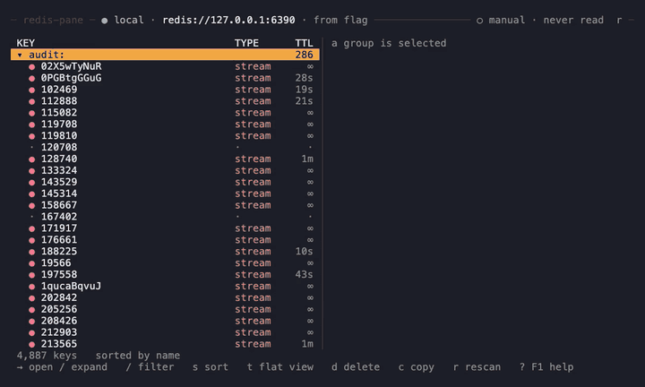
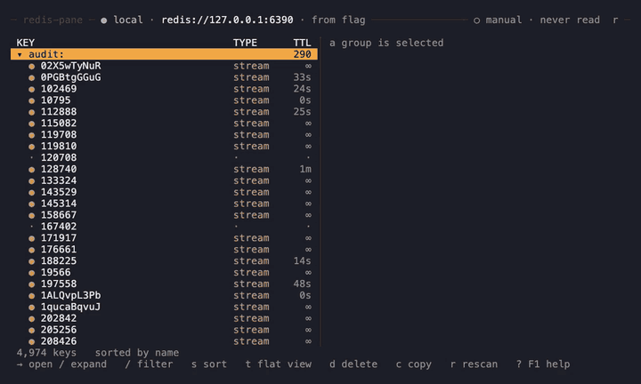
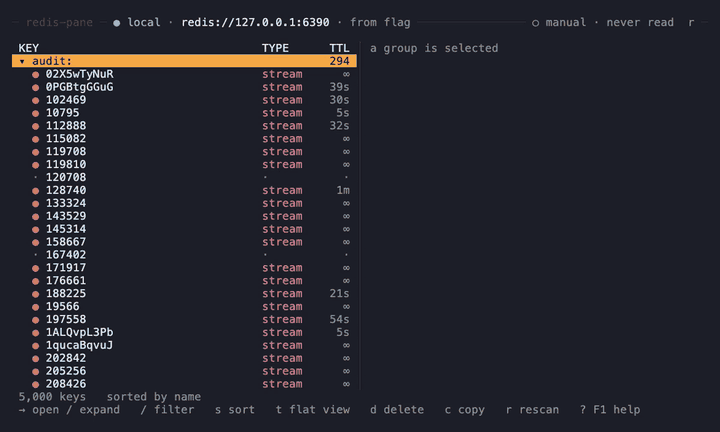

<h1>
  <picture>
    <source media="(prefers-color-scheme: dark)" srcset="site/public/brand/lockup-dark.svg">
    
  </picture>
</h1>

[](https://github.com/redis-pane/redis-pane/actions/workflows/ci.yml)
[](https://github.com/redis-pane/redis-pane/releases)
[](LICENSE)

A terminal UI for the Redis® database and Valkey: see your keyspace, open a key, watch it change, edit it safely.



*Filter to a key, open it, and watch it update live the moment it changes on the server. There is
no refresh button.*

```bash
brew install redis-pane/tap/redis-pane
```

Other platforms: see [Install](#install).

## Why

`redis-cli` runs commands but can't show you what is in your keyspace. RedisInsight can, but it is
a desktop GUI, so it is no use in an SSH session on a bastion host. `redis-pane` is one small
binary that runs in the terminal you are already in, driven from the keyboard.

The story behind it: [The Refresh Button That Didn't Refresh](https://vinodsantharam.github.io/blog/the-refresh-button-that-didnt-refresh/).

| | redis-pane | `redis-cli` | RedisInsight |
| --- | :---: | :---: | :---: |
| Runs in a terminal and over SSH | ✓ | ✓ | ✗ [^1] |
| Single binary | ✓ (2.7 MB download [^2]) | ✓ | ✗ [^3] |
| The open key updates live, by push, with no refresh | ✓ | ✗ | partial [^4] |
| A million keys browsable | ✓ (measured [^5]) | partial [^6] | not measured [^7] |
| The exact command is shown before every write | ✓ | ✗ [^8] | not documented [^9] |
| Writes are locked by Environment | ✓ | ✗ [^8] | not documented [^9] |
| Cluster | ✓ | ✓ [^10] | ✓ [^11] |
| Sentinel | ✓ | ✗ [^12] | ✓ [^11] |

[^1]: RedisInsight describes itself as a "desktop GUI client" built on Electron, also shipped as a Docker image. It has no terminal interface.
[^2]: The `redis-pane-aarch64-apple-darwin.tar.xz` asset of release `1.0.0` is 2.7 MB. The five platform downloads range from 2.7 MB to 5.5 MB (the Windows zip).
[^3]: An Electron desktop application, or a Docker image, per its README.
[^4]: Its documentation describes a configurable automatic refresh rate for Streams and for the Slow Log. It documents no push update for an open key's value.
[^5]: `crates/core/tests/perf.rs` drives 1,000,000 keys in real `SCAN` order. No single update, which includes any slice of a rebuild, takes longer than the 16 ms frame budget.
[^6]: `redis-cli --scan` streams the names of every key, with `--pattern` to filter. It doesn't browse, show types or open values.
[^7]: We have not measured other tools and make no claim about them.
[^8]: `redis-cli` runs what you type. Nothing previews it and nothing locks it.
[^9]: We found no mention of a command preview, a read-only mode or an Environment lock in its README or documentation. We have not tested it, so this is "not documented", not "absent".
[^10]: `redis-cli -c` follows `-MOVED` and `-ASK` redirections, and `--cluster` runs the cluster manager commands.
[^11]: Its documentation says you can add "any Redis database running anywhere (including Redis Open Source cluster or sentinel)".
[^12]: `redis-cli --help` has no Sentinel option. A Sentinel node can be queried as an ordinary server.

## Features

**Browse**
- Keys stream in with `SCAN` (never `KEYS`) and the list is usable while they arrive.
- Tree or flat view, filter by substring or glob, and five sort orders.
- Type, memory and TTL fill in as you scroll. Every Redis type has its own view.
- Your pane split, filter, sort and selected key come back when you relaunch.

→ [docs](https://redis-pane.github.io/redis-pane/docs/browsing/key-list/)

**See it live**
- The open key updates the moment another client changes it, pushed by the server.
- If live updates ever stop working, the header says so. It never goes quietly stale.

→ [docs](https://redis-pane.github.io/redis-pane/docs/viewing/live-updates/)

**Edit safely**
- Edit Strings, Hash fields, List elements, Set members and Sorted set scores in place.
- Change a TTL, rename or duplicate a key, rename a Hash field or member, and bulk-delete marked keys.
- Every write shows the exact command first. Nothing overwrites an existing name.
- Each target has an Environment (`local`, `staging`, `prod`, `unknown`). `prod` and `unknown`
  start in Read-only Mode.

→ [docs](https://redis-pane.github.io/redis-pane/docs/editing/values/)

**Watch the server**
- A Dashboard of memory, hit ratio, ops/sec, clients and replication.
- A live Monitor tail, Pub/Sub (sharded too) and the Slowlog, each a keystroke away.

→ [docs](https://redis-pane.github.io/redis-pane/docs/server/dashboard/)



**Cluster & Sentinel**
- Point it at a `redis-cluster://` URL or any one node. The key list covers every primary and an
  open key stays live on its owner through failovers.
- A `redis-sentinel://` URL resolves to the current master.

→ [docs](https://redis-pane.github.io/redis-pane/docs/connecting/cluster/)

**Fits any terminal**
- Dark, light and high-contrast themes, plus your own.
- ASCII fallback, and a layout that works from a wide terminal down to 80×24.
- The mouse works but is never required.
- Copy goes to your local clipboard over SSH using OSC 52.

→ [docs](https://redis-pane.github.io/redis-pane/docs/appearance/terminal-sizes/)

## What it doesn't do

- No Redis console. There is nowhere to type a raw command, so it doesn't replace `redis-cli` in scripts.
- No moving a key to another database. One Connection means one database, fixed at launch.
- Values aren't opened in your `$EDITOR`, and values over 200 KB can't be edited.
- Keys can't be rebound. The keymap is fixed in this release.
- Streams are a read-only list of the newest 500 entries.
- Keys beyond 2,000,000 aren't loaded. Bulk delete marks only loaded keys, one at a time.
- Not a server manager, an alerting tool or a metrics store, and no multi-server workspace.

The full list is [Limits and non-goals](https://redis-pane.github.io/redis-pane/docs/limits/).

## Install

With [Homebrew](https://brew.sh), on macOS or Linux:

```bash
brew install redis-pane/tap/redis-pane
```

The formula installs the static musl build on Linux. On macOS, a Homebrew install skips the
first-run prompt the unsigned release binaries get.

Or download the binary for your OS from the [Releases page](https://github.com/redis-pane/redis-pane/releases) — macOS, Linux (static musl builds for x86_64 and arm64, which run on any distro, including old ones such as Amazon Linux 2, RHEL 8 and Debian 11) and Windows are all covered. Or run the install script:

```bash
curl --proto '=https' --tlsv1.2 -LsSf https://github.com/redis-pane/redis-pane/releases/latest/download/redis-pane-installer.sh | sh
```

On Windows (experimental, see [Compatibility](#compatibility)), from PowerShell:

```powershell
irm https://github.com/redis-pane/redis-pane/releases/latest/download/redis-pane-installer.ps1 | iex
```

The binaries are unsigned, so your OS may flag them on first run — on macOS, right-click the
binary → Open → confirm; on Windows, click "More info" → "Run anyway" in the SmartScreen prompt.

Prefer to build it yourself? You'll need [Rust](https://rustup.rs):

```bash
git clone https://github.com/redis-pane/redis-pane.git
cd redis-pane
cargo build --release
```

The binary lands at `./target/release/redis-pane`.

## Quick start

```bash
redis-pane                                # 127.0.0.1:6379
redis-pane --url redis://localhost:6379   # a URL, used as given
redis-pane staging                        # a Profile from ~/.config/redis-pane/config.json
```

The keys that matter:

- `↑↓` or `j`/`k` move. `→`/`l` opens a key or expands a group, `←`/`h` collapses.
- `/` filters, `t` toggles tree and flat, `s` cycles the sort, `Enter` moves a cursor into the value.
- `e` edits, `d` deletes, `t` in the value pane sets a TTL. `y` confirms the previewed command.
- `g m`, `g p`, `g s` and `g d` open Monitor, Pub/Sub, Slowlog and Dashboard. `q` quits.

`?` shows every key that works where you are. The full list is the
[keybindings reference](https://redis-pane.github.io/redis-pane/docs/reference/keybindings/).



## Documentation

The user guide is at **<https://redis-pane.github.io/redis-pane/docs>**. Start with
[Connecting](https://redis-pane.github.io/redis-pane/docs/connecting/target/),
[Environments and safety](https://redis-pane.github.io/redis-pane/docs/safety/environments/),
[Editing](https://redis-pane.github.io/redis-pane/docs/editing/values/) and the
[reference](https://redis-pane.github.io/redis-pane/docs/reference/cli/) pages.
Its source is in [`site/content/docs`](site/content/docs/index.mdx).

## Compatibility

- The latest release is on the [Releases page](https://github.com/redis-pane/redis-pane/releases/latest). What isn't built is on the [limits page](https://redis-pane.github.io/redis-pane/docs/limits/).
- Redis 6.0 or newer, and Valkey. RESP3 only.
- Standalone, Sentinel and Cluster, with TLS.
- Prebuilt for macOS (arm64 and x86_64) and Linux (x86_64 and arm64, static musl, any distro). Build from source for anything else.
- **Windows is experimental.** A Windows build ships, but it hasn't been verified on Windows, and
  some things don't work yet ([#138](https://github.com/redis-pane/redis-pane/issues/138)):
  Profiles and session restore need `HOME` set, and `passwordCommand` needs `sh` on your `PATH`.

## Feedback, contributing and license

To report a bug, use the [bug report form](https://github.com/redis-pane/redis-pane/issues/new?template=bug.yml).
For questions and ideas, use [Discussions](https://github.com/redis-pane/redis-pane/discussions). Check the
[limits page](https://redis-pane.github.io/redis-pane/docs/limits/) first, in case it isn't built yet. Please include:

- what you were doing, what you expected, and what happened instead
- the version (`redis-pane --version`)
- what you were connected to: Redis version, and whether it was local, a cloud service or
  something else
- your terminal, and whether you were over SSH
- the output of `redis-pane --print-target` and `redis-pane --probe` for that target, with any
  password removed

To try it without a Redis of your own, `scripts/` gives you a disposable one and a keyspace to put
in it; see [`scripts/README.md`](scripts/README.md). See the
[CHANGELOG](CHANGELOG.md) for what changed.

To work on the code, read [CONTRIBUTING.md](CONTRIBUTING.md). It covers building, testing and
sending a change, and points to the glossary in [CONTEXT.md](CONTEXT.md) and the design docs under
[`docs/`](docs/). Please follow the [Code of Conduct](CODE_OF_CONDUCT.md), and report security
problems as [SECURITY.md](SECURITY.md) describes.

[MIT](LICENSE).

## Trademarks

`redis-pane` is an independent open-source project. It is not affiliated with, endorsed, supported or certified by Redis Ltd. Redis is a registered trademark of Redis Ltd. Any rights therein are reserved to Redis Ltd.
